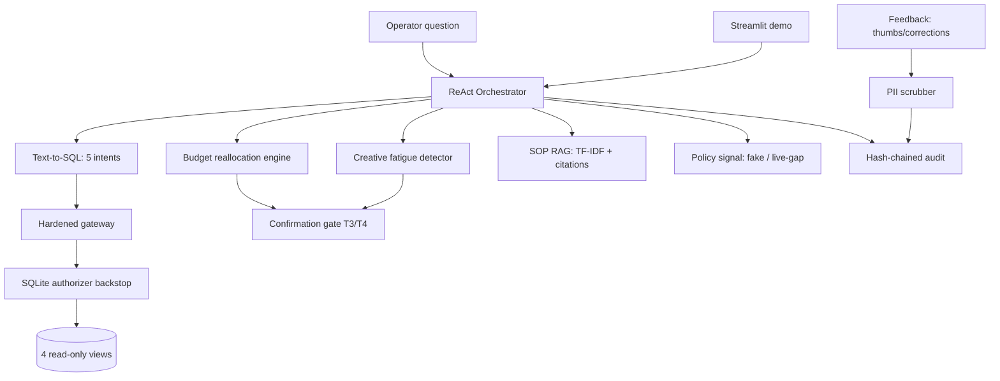

# Architecture



## Module map

| Module | Role |
|---|---|
| `telemetry.py` | Seeded SQLite (seed 42): campaigns, ad sets, creatives, 14d daily stats |
| `views.py` | 4 read-only views + SELECT-only gateway (SEC-SELECT-01/02/03) |
| `authz.py` | Strict SQLite authorizer: base-table reads only via allowed views |
| `text2sql.py` | 5 fixed intents, one retry, then EscalationNeeded |
| `reallocate.py` | ROAS-ranked budget shifts with guardrails + rationales |
| `fatigue.py` | CTR-decay detector (>25% over 7d windows) |
| `sop_rag.py` | TF-IDF over 4 SOPs, `file §section` citations |
| `policysignal.py` | Fake seeded feed; live stub raises SignalGap |
| `orchestrator.py` | ReAct fan-out, audited turns |
| `escalation.py` | T1–T4 tiers, fail-closed confirmation gates |
| `audit.py` | Hash-chained log, tamper detection |
| `pii.py` / `feedback.py` | Scrub-before-store feedback capture |
| `demo_helpers.py` | Testable demo logic |
```
